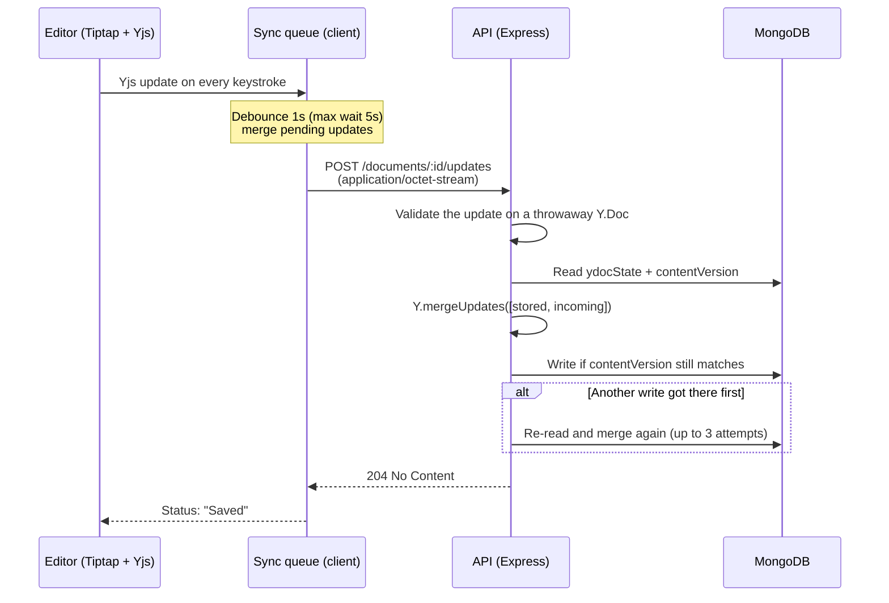

# Collaborative Text Editor

A Notion-style document editor built on **Yjs CRDTs**, designed from day one for real-time collaboration.

[](https://github.com/MikaelMarceniuk/collaborative-text-editor/actions/workflows/server-ci.yml)
[](https://github.com/MikaelMarceniuk/collaborative-text-editor/actions/workflows/web-ci.yml)


**[See it live →](https://collaborative-text-editor.mmarceniuk.dev/)** No account needed, just click **"Continue as guest"**.

<!-- TODO (v0.2): hero screenshot in light and dark mode. See docs/media-capture.md -->

## Highlights

- **CRDT-based document model.** Content is stored as Yjs binary state, not as HTML or JSON. Concurrent edits merge without conflicts, so going real-time doesn't require a data migration.
- **Incremental sync.** The client sends only the changes since its last save, as raw binary. The server merges them and never overwrites the stored state.
- **Optimistic concurrency.** Writes are guarded by a version token and retried on conflict, so two saves arriving at the same time can't erase each other.
- **Resilient autosave.** Debounced saves with a max-wait cap, exponential backoff on network errors, and a final flush when the tab closes.
- **Guest mode.** Try the app without an account. Signing up later keeps the guest's documents, and abandoned guest accounts are cleaned up by a daily job.
- **Role-based access.** Every document has members with an `owner`, `editor` or `viewer` role, enforced on every API route.
- **CI/CD.** Lint, format and type checks on every push. Publishing a GitHub release deploys the API to Fly.io and then the web app to Vercel.

## Tech stack

| Layer               | Technologies                                                                                            |
| ------------------- | ------------------------------------------------------------------------------------------------------- |
| **Frontend**        | React 19, TypeScript, Vite, Tiptap (ProseMirror), TanStack Query, React Router, Tailwind CSS, shadcn/ui |
| **Backend**         | Node.js, Express 5, TypeScript, Zod                                                                     |
| **Collaboration**   | Yjs (CRDT)                                                                                              |
| **Auth**            | Better Auth (email + password, email verification, anonymous guests), Resend                            |
| **Database**        | MongoDB (native driver)                                                                                 |
| **Tooling & infra** | pnpm workspaces, Oxlint, Oxfmt, Docker, GitHub Actions, Fly.io, Vercel                                  |

## How saving works



When the document opens, the client loads the full state once (`GET /documents/:id/content`). After that, only incremental updates go over the wire. This is the same protocol a WebSocket connection will use, so moving to real-time only changes the transport.

## Engineering decisions

**Why a CRDT instead of "last write wins"?**
With last write wins, two tabs or two users editing the same document overwrite each other's work. Yjs updates are commutative and idempotent: they can arrive in any order, or more than once, and every replica ends up with the same document. That also makes retries after a network error safe.

**Why Yjs before real-time exists?**
Saving Tiptap JSON first would mean migrating every document and rewriting the save path once collaboration arrives. Starting with Yjs keeps the database format, the server-side merge and the editor integration unchanged. Only the transport changes, from REST to WebSocket.

**Why binary instead of base64 in JSON?**
Base64 adds about 33% to the payload, and WebSockets carry binary natively. Updates go out as `application/octet-stream`, parsed with `express.raw()` on that route only.

**Why optimistic concurrency on a CRDT?**
The merge itself can't conflict, but the read-merge-write cycle can: two requests that read the same state at the same time would each write a version missing the other's update. A `contentVersion` token in the update filter catches this, and the server retries with fresh state.

## Project structure

```
apps/
├── server/          # Express API
│   └── src/
│       ├── config/      # env validation, MongoDB, Better Auth, mailer
│       ├── https/       # routes and middleware
│       ├── services/    # Yjs merge, guest document transfer
│       └── jobs/        # abandoned guest cleanup
└── web/             # React SPA
    └── src/
        ├── components/  # UI, editor (Tiptap), forms
        ├── hooks/       # TanStack Query hooks
        ├── lib/         # API client, document sync queue
        └── pages/       # routes
```

<!--
## Running locally

TODO (v0.2): Docker Compose with MongoDB as a replica set + `pnpm dev`.
See docs/local-development.md
-->

## Roadmap

- [x] Auth with email verification and guest mode
- [x] Document CRUD with role-based access
- [x] Rich text editor (headings, lists, checklists, highlight, find and replace)
- [x] CRDT persistence with incremental sync and resilient autosave
- [x] CI/CD to Fly.io and Vercel
- [ ] Real-time collaboration over WebSocket
- [ ] Live presence: other users' cursors and selections
- [ ] Share documents by email with roles
- [ ] One-command local setup with Docker Compose
- [ ] Integration and E2E tests (two browsers editing the same document)
- [ ] Version history with snapshots

## Author

**Mikael Campos Marceniuk**: [LinkedIn](https://www.linkedin.com/in/mikael-marceniuk/) · [GitHub](https://github.com/MikaelMarceniuk)

Open to opportunities. Feel free to reach out.
