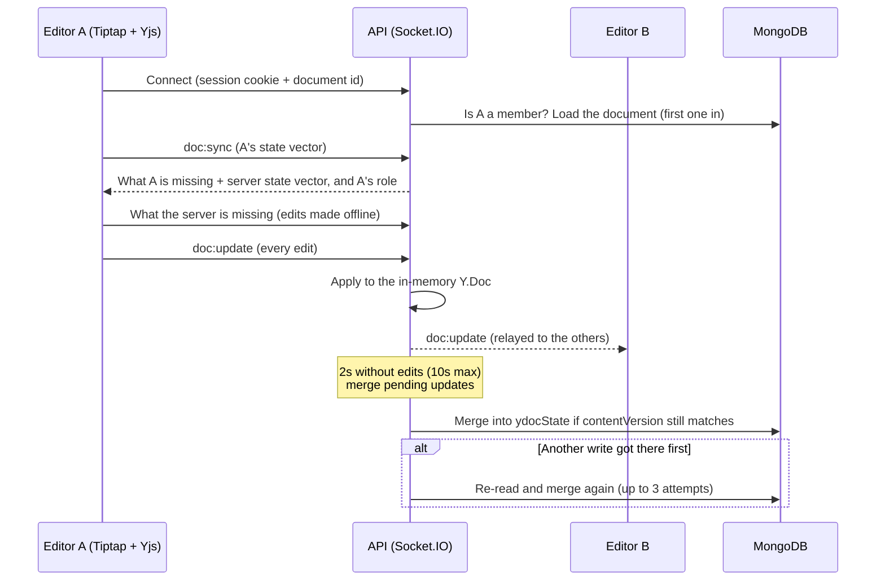

# Collaborative Text Editor

A Notion-style document editor built on **Yjs CRDTs**, designed from day one for real-time collaboration.

[](https://github.com/MikaelMarceniuk/collaborative-text-editor/actions/workflows/server-ci.yml)
[](https://github.com/MikaelMarceniuk/collaborative-text-editor/actions/workflows/web-ci.yml)


**[See it live →](https://collaborative-text-editor.mmarceniuk.dev/)** No account needed, just click **"Continue as guest"**.

<!-- TODO (v0.2): hero screenshot in light and dark mode. See docs/media-capture.md -->

## Highlights

- **Real-time collaboration.** Several people edit the same document at once over Socket.IO. Edits are relayed as they happen, and the document converges without conflicts.
- **CRDT-based document model.** Content is stored as Yjs binary state, not as HTML or JSON. Concurrent edits merge without conflicts.
- **Sync by state vector.** On every connection the client and the server exchange what each is missing. Edits made while offline, or lost by a server restart, come back on reconnection, with no retry queue.
- **Debounced persistence.** The server keeps each open document in memory and saves it to MongoDB after 2s without edits (10s at most), when the last person leaves, and on shutdown. Saves merge into the stored state and never overwrite it.
- **Optimistic concurrency.** Writes are guarded by a version token and retried on conflict, so two saves arriving at the same time can't erase each other.
- **Guest mode.** Try the app without an account. Signing up later keeps the guest's documents, and abandoned guest accounts are cleaned up by a daily job.
- **Sharing with roles.** The owner invites people by email as `editor` or `viewer`, changes their role or removes them. Roles are enforced on every API route and on every socket. A role change or a removal disconnects that member right away, and they come back with the new role (or not at all).
- **Tested permissions.** Vitest, Supertest and socket.io-client cover every document route and the socket for each role, against a real MongoDB.
- **CI/CD.** Lint, format, type checks and tests on every push. Publishing a GitHub release deploys the API to Fly.io and then the web app to Vercel.

## Tech stack

| Layer               | Technologies                                                                                            |
| ------------------- | ------------------------------------------------------------------------------------------------------- |
| **Frontend**        | React 19, TypeScript, Vite, Tiptap (ProseMirror), TanStack Query, React Router, Tailwind CSS, shadcn/ui |
| **Backend**         | Node.js, Express 5, TypeScript, Zod                                                                     |
| **Collaboration**   | Yjs (CRDT), Socket.IO                                                                                   |
| **Auth**            | Better Auth (email + password, email verification, anonymous guests), Resend                            |
| **Database**        | MongoDB (native driver)                                                                                 |
| **Testing**         | Vitest, Supertest                                                                                       |
| **Tooling & infra** | pnpm workspaces, Oxlint, Oxfmt, Docker, GitHub Actions, Fly.io, Vercel                                  |

## How real-time sync works



The same two steps run on the first connection and on every reconnection, so the client needs no queue of unsent updates: whatever the server lacks is the difference between the two state vectors. Viewers receive updates but the server rejects the ones they send. When the owner changes a role or removes someone, that member's sockets are disconnected, and the handshake that follows reads the new role.

## Engineering decisions

**Why a CRDT instead of "last write wins"?**
With last write wins, two tabs or two users editing the same document overwrite each other's work. Yjs updates are commutative and idempotent: they can arrive in any order, or more than once, and every replica ends up with the same document. That also makes retries after a network error safe.

**Why Yjs before real-time existed?**
Saving Tiptap JSON first would have meant migrating every document and rewriting the save path once collaboration arrived. Starting with Yjs kept the database format, the server-side merge and the editor integration unchanged. Only the transport changed, from REST to a socket.

**Why binary instead of base64 in JSON?**
Base64 adds about 33% to the payload, and Socket.IO carries binary natively, so updates travel as raw bytes.

**Why does the server keep a Y.Doc per open document?**
It answers each sync without a trip to MongoDB and gives every client the same view of the document. MongoDB stays the source of truth: the room is loaded on the first join, saved with a debounce, and dropped when the last person leaves.

**Why WebSocket only, with no long-polling fallback?**
Polling needs sticky sessions as soon as there is more than one server instance. Every current browser supports WebSocket.

**Why optimistic concurrency on a CRDT?**
The merge itself can't conflict, but the read-merge-write cycle can: two saves that read the same state at the same time would each write a version missing the other's update. A `contentVersion` token in the update filter catches this, and the server retries with fresh state.

## Project structure

```
apps/
├── server/          # Express API
│   └── src/
│       ├── config/      # env validation, MongoDB, Better Auth, mailer
│       ├── https/       # routes and middleware
│       ├── services/    # Yjs merge, guest document transfer
│       └── jobs/        # abandoned guest cleanup
└── web/             # React SPA
    └── src/
        ├── components/  # UI, editor (Tiptap), forms
        ├── hooks/       # TanStack Query hooks
        ├── lib/         # API client, document sync queue
        └── pages/       # routes
```

## Running locally

Requires Node 24, pnpm and Docker.

```bash
pnpm install
cp apps/server/.env.example apps/server/.env   # set BETTER_AUTH_SECRET (openssl rand -base64 32)
pnpm dev
```

- Web: http://localhost:5173
- API: http://localhost:3333 (Vite proxies `/api` to it)

`pnpm dev` starts MongoDB in Docker, then the API and the web app in the same terminal. MongoDB runs as a single-node replica set because Better Auth uses transactions on sign-up. The data lives in `.docker-data/`.

`RESEND_API_KEY` is optional in development: verification emails are printed in the API's console instead of being sent. Or skip sign-up entirely with **"Continue as guest"**.

`Ctrl+C` stops the API and the web app but leaves MongoDB running. Use `pnpm dev:down` to stop it too.

### Tests

```bash
pnpm dev                                    # or: docker compose -f compose-dev.yml up -d --wait
pnpm --filter @collaborative-text-editor/server test
```

The server tests run against the local MongoDB, in a separate `collaborative-editor-test` database (override it with `TEST_MONGO_URL`).

## Roadmap

- [x] Auth with email verification and guest mode
- [x] Document CRUD with role-based access
- [x] Rich text editor (headings, lists, checklists, highlight, find and replace)
- [x] CRDT persistence with incremental sync and resilient autosave
- [x] CI/CD to Fly.io and Vercel
- [x] Real-time collaboration over Socket.IO
- [ ] Live presence: other users' cursors and selections
- [x] Share documents by email with roles
- [x] One-command local setup with Docker Compose
- [ ] Integration and E2E tests (two browsers editing the same document)
- [ ] Version history with snapshots

## Author

**Mikael Campos Marceniuk**: [LinkedIn](https://www.linkedin.com/in/mikael-marceniuk/) · [GitHub](https://github.com/MikaelMarceniuk)

Open to opportunities. Feel free to reach out.
